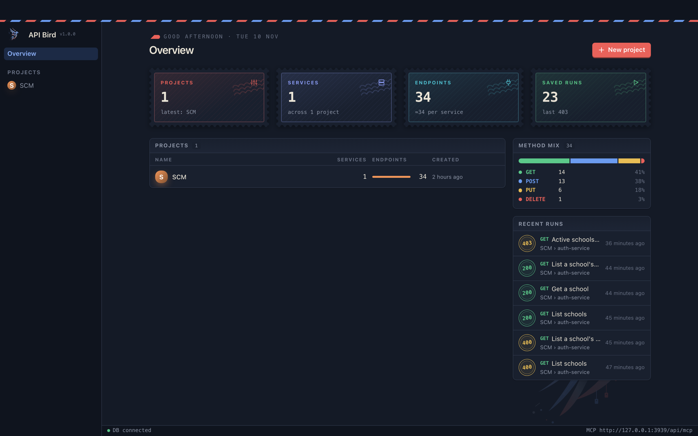
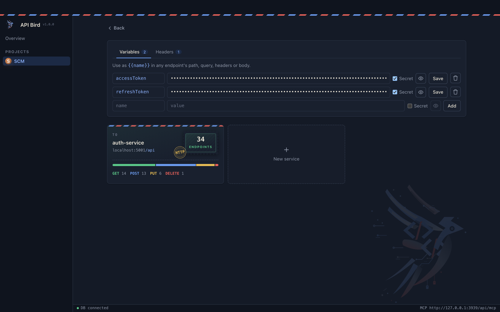
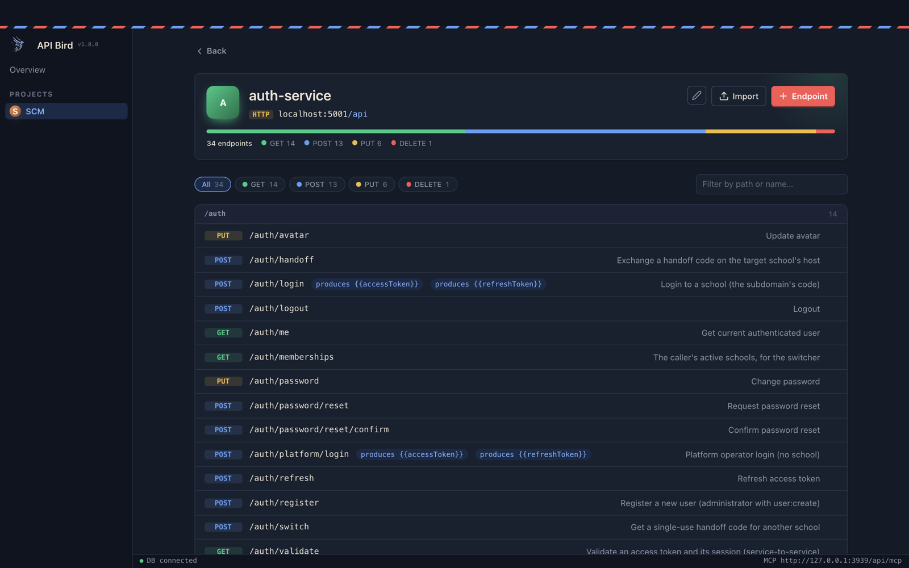
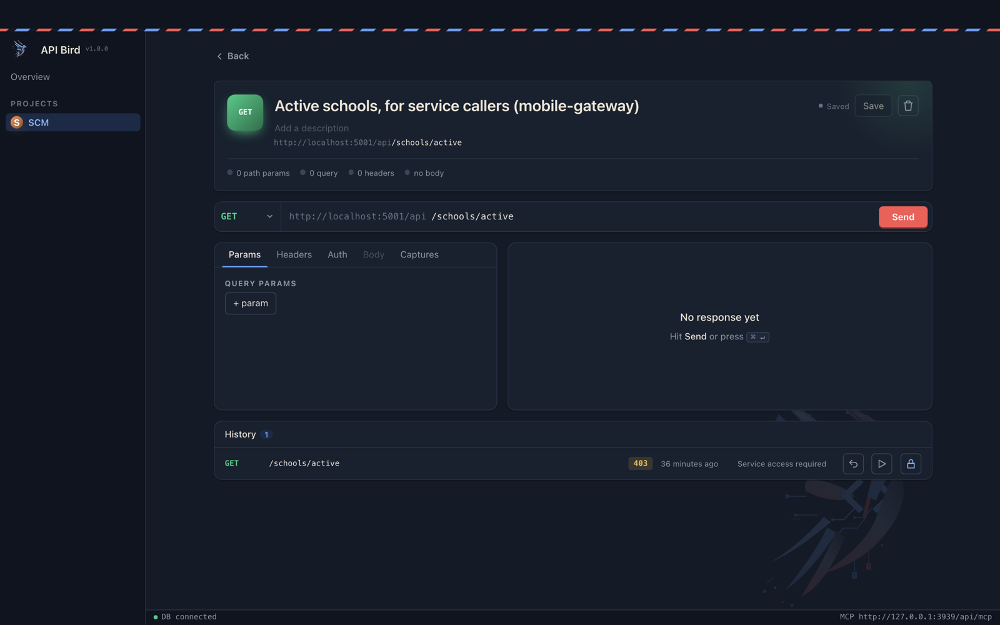

# API Bird

A local API workbench. Organise APIs as **projects → services → endpoints**, run requests against them, and let Claude (or any MCP client) do the same over MCP.

- **Projects** hold variables (`{{name}}`, optionally secret) and shared headers.
- **Services** have a base URL and auth (bearer, basic, or API key in header/query).
- **Endpoints** are method + path with headers, query, and body. Import them from an OpenAPI doc (YAML or JSON).
- **Requests** are saved per endpoint and can be replayed. Response values can be captured into variables.

Built with Next.js 16, React 19, Tailwind 4, and MongoDB.



| Project variables & services | Service endpoints | Endpoint runner |
| --- | --- | --- |
|  |  |  |

## Setup

Requires Node 20+ and a running MongoDB.

```sh
npm install
cp .env.example .env.local   # set MONGODB_URI
npm run dev -- -H 127.0.0.1
```

Open http://localhost:3000.

## MCP

The app serves an MCP endpoint at `/api/mcp`. Register it with Claude Code:

```sh
claude mcp add api-bird --transport http http://localhost:3000/api/mcp
```

Tools cover listing/reading projects, services, endpoints and saved requests, `run_endpoint`, `run_request`, `import_openapi`, and creating/updating endpoints. Secrets are masked in responses.

> **No auth.** `run_endpoint` makes the server send requests anywhere, so bind to localhost only (`-H 127.0.0.1`).

## Desktop app

macOS (`.dmg`, Apple Silicon or Intel) and Windows (`.exe`) installers are on the [releases page](https://git.tinkeshwar.in/HomeServer/api-bird/releases).

**First launch.** The installers are unsigned, so the OS blocks them once:

- **macOS:** right-click the app in Applications → **Open** → **Open**. Or run `xattr -dr com.apple.quarantine "/Applications/API Bird.app"`.
- **Windows:** on the SmartScreen prompt, click **More info** → **Run anyway**.

**Setup.** The first window asks where to store data:

- **Built-in storage** (default): files in the app's data folder, nothing else to install.
- **MongoDB:** a local `mongod`, Docker (`docker run -d -p 27017:27017 mongo`) or Atlas. The URI must include a database name, e.g. `mongodb://127.0.0.1:27017/api-bird`.

The app serves on `127.0.0.1:3940` by default (changeable in setup). The MCP URL is `http://127.0.0.1:3940/api/mcp`; **File → Copy MCP URL** copies it. **File → Change database…** reopens setup.

### Releasing

Merging to `main` on Forgejo bumps the version and tags it (`commit-and-tag-version`), then mirrors to GitHub. The `v*` tag triggers [release.yml](.github/workflows/release.yml), which tests, builds the `.dmg` (macOS) and `.exe` (Windows) installers, and attaches them to a **draft** GitHub release. Review it and publish.

To build locally instead: `npm run desktop:build` on each OS → installers in `release/`.

## Scripts

| Command | Does |
| --- | --- |
| `npm run dev` | Dev server |
| `npm run build` / `npm start` | Production build / serve |
| `npm run lint` | ESLint |
| `npm test` | `node --test` on `src/lib`, `src/mcp` and `electron` |
| `npm run desktop:dev` | Build and run the desktop app from source |
| `npm run desktop:build` | Build installers for the current OS into `release/` |

## Layout

- `src/app/` — routes, server actions (`actions.ts`), MCP route (`api/mcp`)
- `src/app/(app)/dev/` — UI component prototypes
- `src/components/` — UI components
- `src/lib/` — db, variables/auth, OpenAPI parser
- `src/mcp/tools.ts` — MCP tool definitions
